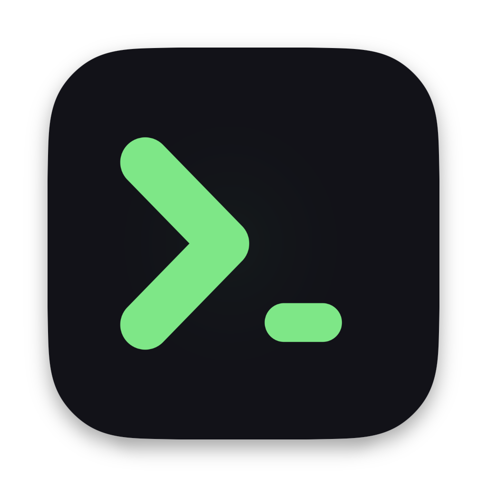

<p align="center">
  
</p>

<h1 align="center">Vibe</h1>

<p align="center">A terminal-first code editor written in Go. A native GPU UI with
<a href="https://github.com/egoist/mygo">MyGo</a>, the terminal from Ghostty's
<code>libghostty-vt</code>, no webview and no Electron.</p>

Vibe is an early fork of [Mayoi](https://github.com/sorrycc/Mayoi), reshaped
around a terminal instead of a file editor. The terminal is the center view;
files and diffs open over it, and closing the last tab returns to it.

## What it does

- **Workspaces in the left panel.** Each workspace is a folder with its own
  list of terminals. One window can hold several workspaces.
- **A terminal in the center.** Every workspace starts its own shell at
  launch. Terminals keep running while you edit.
- **Explorer and Source Control on the right.** Those are the only two
  sidebar views. Search, sessions, GitHub, plugins and account features are
  not part of this build.
- **An editor when you need one.** Open a file from the Explorer, quick open
  or a diff; the editor takes the center until you close its last tab.
- **No AI backend.** Commit messages, chat and agent panels are not included.

## Status

Version 0.1.0 is an early preview for macOS. Linux and Windows builds come
from the same source but have had less testing.

## Run it

Requires Go 1.27 or later.

```sh
git clone https://github.com/ricardo33550336/vibe-ide-go
cd vibe-ide-go
go run ./cmd/vibe ~/some/project
```

The first run downloads MyGo's native libraries, including
`libghostty-vt`, into `~/Library/Caches/mygo/natives`.

## Build the app

```sh
go tool mygo build
```

On macOS this writes `build/darwin-amd64/Vibe.app` (or `darwin-arm64`) and a
`.dmg` beside it. The build is ad-hoc signed; set a Developer ID in
`mygo.json` to sign and notarize a build for other people.

## Keys

| Shortcut | Action |
|---|---|
| ⌘B | Show or hide the workspace panel |
| ⌃\` | Toggle terminal / editor |
| ⌃⇧\` | New terminal in the current workspace |
| ⌘P | Quick open |
| ⇧⌘F / ⇧⌘H | Find in files / replace in files |
| ⌘S | Save |
| ⌘W | Close tab; the last tab returns to the terminal |
| ⌘1…9, ⌃Tab | Go to tab / next tab |
| ⌘Z / ⇧⌘Z | Undo / redo |

## Development

```sh
scripts/dev.sh                 # Vibe Dev, with its own settings
go test -short ./cmd/vibe      # headless UI tests
go test ./cmd/vibe             # also tests that start a shell
go run ./tools/brandicon       # redraw the icon art
go run ./tools/icongen         # redraw resources/icon.png
```

See [CONTRIBUTING.md](CONTRIBUTING.md) and [docs/](docs/) for the inherited
architecture notes. Some pages still describe features this fork removed.

## Credits

Vibe is derived from [Mayoi](https://github.com/sorrycc/Mayoi), MIT licensed,
and keeps its copyright notice. It also builds on:

- [MyGo](https://github.com/egoist/mygo), the native Go UI toolkit
- [Ghostty](https://github.com/ghostty-org/ghostty) and `libghostty-vt`
- [creack/pty](https://github.com/creack/pty) for local terminals
- [Chroma](https://github.com/alecthomas/chroma) and the other modules in
  `go.mod`

Vibe is not affiliated with Mayoi, Ghostty or the original vibe-ide project.

## License

[MIT](LICENSE). See [NOTICE](NOTICE) for attribution.
